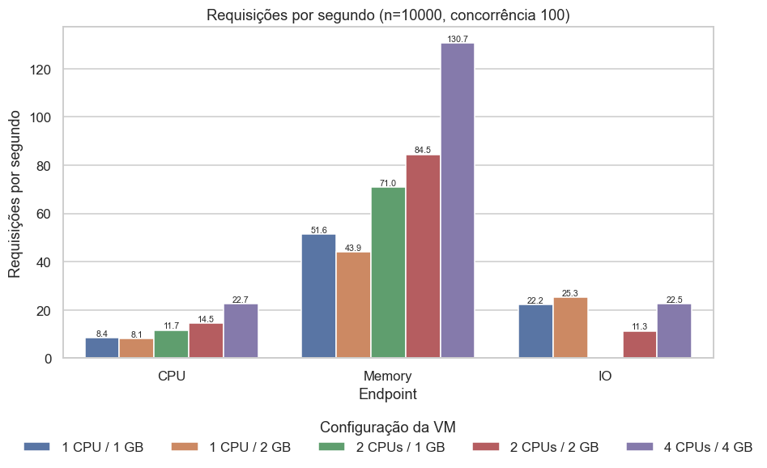
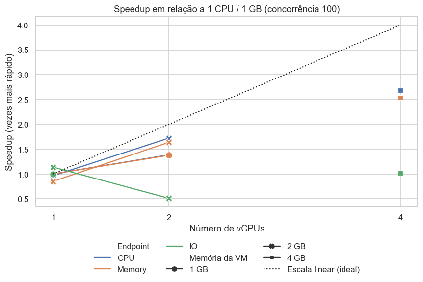
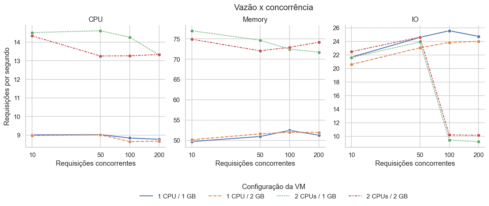
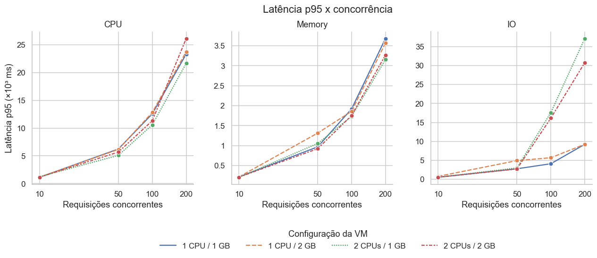
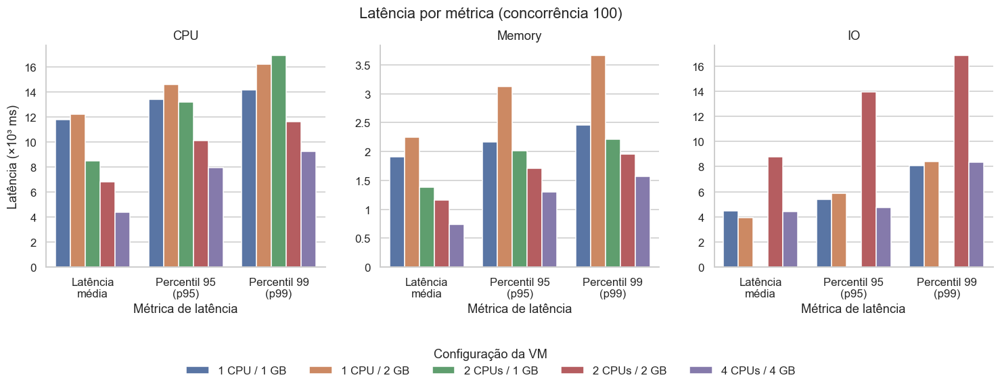
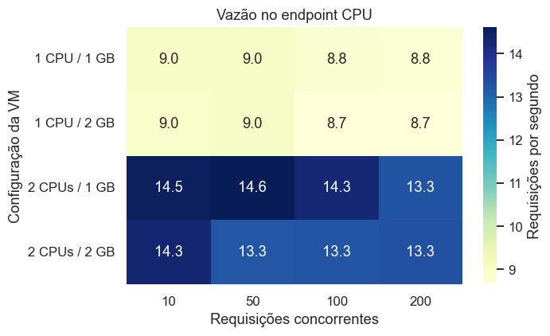
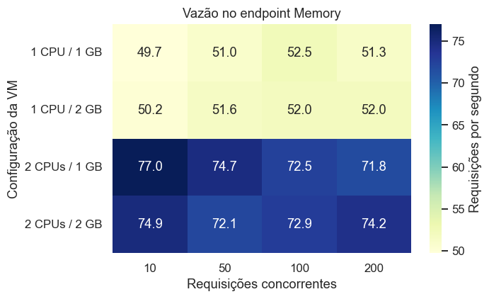
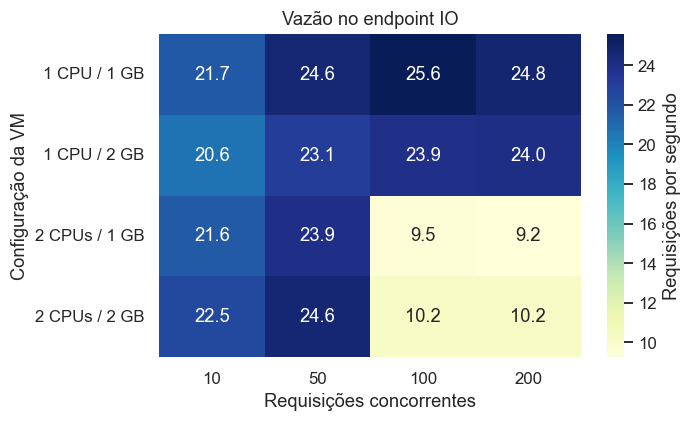
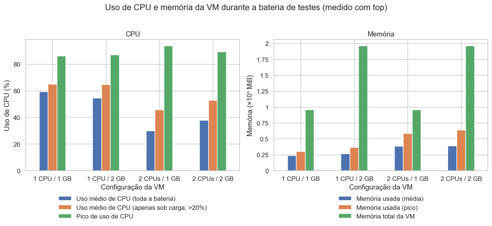

# Demanda, Provisionamento e Desempenho

Grupo: **[preencher: nomes e matrículas]**

## 1. Aplicações desenvolvidas

As três aplicações são endpoints de um único backend em Python (FastAPI, servido por Uvicorn), em `app/server.py`. Cada endpoint tem um perfil computacional diferente e um parâmetro que controla o tamanho da tarefa.

| Endpoint | Perfil | O que faz | Parâmetro usado nos testes |
| --- | --- | --- | --- |
| `/cpu` | CPU-bound | Laço de `n` iterações acumulando `i * i` | `n = 3.000.000` |
| `/memory` | Memory-bound | Aloca uma matriz `size x size` e soma todos os elementos | `size = 1500` |
| `/io` | IO-bound | Repete `size` ciclos de escrita de 1 MB em arquivo temporário (com `flush` e `fsync`) seguida de leitura | `size = 20` |

Os três parâmetros são os valores padrão do repositório. Todas as requisições têm o mesmo custo, de modo que a única variável de demanda é a concorrência.

### Monitoramento

- **Aplicação:** as métricas de desempenho (vazão, tempo de resposta, percentis e falhas) vêm do ApacheBench (`ab`).
- **Infraestrutura:** dentro da VM, o script `iniciate.sh` grava a saída do `top` a cada 1 segundo (uso de CPU em `us`/`sy`/`id`/`si` e memória usada/livre). Isso gera um arquivo `recursos_<cenário>.txt` por cenário.

## 2. Configuração da VM e deploy da aplicação

### Máquina virtual

1. VM criada no VirtualBox a partir do disco `ubuntu_server_2204_poi.vdi` (Ubuntu Server 22.04), seguindo o roteiro da disciplina.
2. Os recursos (vCPUs e RAM) foram alterados entre os cenários, com a VM desligada.
3. Redirecionamento de portas na rede da VM: porta 8080 do hospedeiro para a porta 8080 do convidado. Assim a carga é gerada de fora da VM, no hospedeiro, em `http://localhost:8080`.

*[Inserir screenshots da criação da VM e do redirecionamento de portas.]*

### Deploy

Requisitos: Python 3, as dependências de `app/requirements.txt` e o repositório clonado na VM.

```
pip install -r app/requirements.txt
./iniciate.sh <nº de workers> <nome do cenário>
```

O `iniciate.sh` liga o monitoramento com `top` e sobe `uvicorn app.server:app --host 0.0.0.0 --port 8080 --workers N`. O número de workers foi sempre igual ao número de vCPUs do cenário. Ao encerrar o servidor, o script para o `top`.

## 3. Teste de stress

### Cenários de provisionamento

| Cenário | vCPUs | RAM | Workers Uvicorn | Observação |
| --- | --- | --- | --- | --- |
| 1 CPU / 1 GB | 1 | 1 GB | 1 | referência |
| 1 CPU / 2 GB | 1 | 2 GB | 1 | isola o efeito da memória |
| 2 CPUs / 1 GB | 2 | 1 GB | 2 | isola o efeito da CPU |
| 2 CPUs / 2 GB | 2 | 2 GB | 2 | |
| 4 CPUs / 4 GB | 4 | 4 GB | 4 | só no teste de carga longa (sem bateria nem `top`) |

### Como os testes foram feitos

A carga foi gerada com `ab.exe` na máquina hospedeira, fora da VM. Foram dois conjuntos de testes:

- **Bateria de concorrência** (`testes_ab.ps1`): `ab -n 1000 -c C`, com C em 10, 50, 100 e 200, para cada um dos três endpoints, com 2 s de pausa entre testes. Cobre os quatro primeiros cenários. Nela, a "demanda" é o número de requisições simultâneas.
- **Carga longa:** `ab -n 10000 -c 100` por endpoint, para os cinco cenários.

Cada combinação foi executada uma vez, então não há barras de erro.

### Observações sobre os dados

- O teste de carga longa em `/io` no cenário 2 CPUs / 1 GB **foi descartado**: ele sempre falhava. Em uma das tentativas, o `ab` registrou "Host system reported disk full. VM execution is suspended" e só 2344 de 10000 requisições foram concluídas. Os outros testes desse cenário (bateria) terminaram normalmente e estão nos gráficos.
- O uso de CPU do gráfico de recursos é `us + sy` (usuário + sistema). O tempo de interrupção de rede (`si`) fica de fora, então o valor real de ocupação é maior, principalmente com 1 vCPU (ver seção 4.6).
- O `top` registra a bateria inteira, incluindo as pausas. Por isso mostro também a CPU média "sob carga", que só considera amostras com uso acima de 20%.
- No cenário 4 CPUs / 4 GB não há dados de `top`.

## 4. Resultados

### 4.1 Vazão na carga longa



O gráfico mostra as requisições por segundo de cada cenário, por endpoint, com 100 requisições simultâneas.

| Cenário | CPU (req/s) | Memory (req/s) | IO (req/s) |
| --- | --- | --- | --- |
| 1 CPU / 1 GB | 8,43 | 51,57 | 22,25 |
| 1 CPU / 2 GB | 8,13 | 43,92 | 25,30 |
| 2 CPUs / 1 GB | 11,68 | 71,05 | descartado |
| 2 CPUs / 2 GB | 14,52 | 84,49 | 11,35 |
| 4 CPUs / 4 GB | 22,67 | 130,74 | 22,53 |

- **CPU e Memory** crescem com as vCPUs. Dobrar a RAM com 1 vCPU não ajuda (8,43 contra 8,13 em CPU; a queda de 51,6 para 43,9 em Memory é variação entre execuções, pois na bateria os dois cenários dão cerca de 52 req/s).
- **IO** não acompanha as vCPUs. É o único endpoint em que mais recursos deram resultado pior (ver 4.3).

### 4.2 Speedup em relação a 1 CPU / 1 GB



O gráfico divide a vazão de cada cenário pela do 1 CPU / 1 GB e compara com o ganho linear ideal (4 vCPUs = 4x).

| Endpoint | 2 CPUs / 2 GB | 4 CPUs / 4 GB |
| --- | --- | --- |
| CPU | 1,72x | 2,69x |
| Memory | 1,64x | 2,54x |
| IO | 0,51x | 1,01x |

CPU e Memory escalam, mas abaixo do linear: com 4 vCPUs o ganho é de cerca de 2,6x, e não 4x. A vazão por vCPU em `/cpu` cai de 8,4 (1 vCPU) para 5,7 (4 vCPUs). Uma causa provável é que a VM compartilha o processador do hospedeiro com o próprio gerador de carga (`ab`) e com o processamento de rede, mas esse experimento não isola isso.

### 4.3 Efeito da demanda: vazão e latência





Estes dois gráficos vêm da bateria (n=1000). Eles mostram o que acontece quando a demanda aumenta com os recursos fixos.

**CPU e Memory: saturação.** A vazão fica praticamente constante quando a concorrência sobe, e a latência cresce em proporção à demanda. Em 1 CPU / 1 GB e `/cpu`, a vazão vai de 9,01 req/s (c=10) para 8,77 req/s (c=200), enquanto a latência média vai de 1087 ms para 20.870 ms, cerca de 19 vezes para 20 vezes mais demanda. O servidor já está no limite com poucas requisições simultâneas, e as demais ficam esperando em fila. Com 2 CPUs a curva tem o mesmo formato, deslocada para cima (cerca de 14 req/s), e a latência com c=200 cai de 20,9 s para 13,7 s.

**IO com 2 CPUs: degradação.** Com 1 CPU, a vazão em `/io` fica estável em cerca de 24-25 req/s de c=50 em diante. Com 2 CPUs ela cai de 24 req/s (c=50) para cerca de 9-10 req/s (c=100 e c=200), mesmo com mais CPU:

| Cenário | c=50 | c=100 | c=200 |
| --- | --- | --- | --- |
| 2 CPUs / 1 GB | 23,9 req/s, p95 3,0 s | 9,5 req/s, p95 17,6 s | 9,2 req/s, p95 37,1 s |
| 2 CPUs / 2 GB | 24,7 req/s, p95 2,7 s | 10,2 req/s, p95 16,1 s | 10,2 req/s, p95 30,8 s |

Esta é a situação clara em que aumentar a demanda degrada o desempenho (a vazão cai pela metade e a latência p95 sobe de 3 s para 17 s ao dobrar a concorrência). O 1 CPU / 1 GB e o 1 CPU / 2 GB não sofrem a queda. O 4 CPUs / 4 GB tem 22,5 req/s em c=100 na carga longa, então também não cai nesse ponto.

O experimento mostra que a queda existe, mas não prova a causa. A hipótese mais provável é disputa pelo disco: o endpoint chama `fsync` a cada ciclo, e com 2 workers em paralelo as escritas síncronas competem pelo mesmo disco virtual (um arquivo VDI do hospedeiro), que passa a ser o gargalo. A queda de espaço no host no 2 CPUs / 1 GB é coerente com pressão no armazenamento, mas também não foi investigada. Para confirmar seria preciso medir o `iowait` e o disco por requisição (por exemplo com `iostat`).

### 4.4 Latência na carga longa



Latência média, p95 e p99 por cenário (c=100). Valores em segundos, para `/cpu`:

| Cenário | Média | p95 | p99 | Máx. |
| --- | --- | --- | --- | --- |
| 1 CPU / 1 GB | 11,8 | 13,4 | 14,2 | 16,2 |
| 1 CPU / 2 GB | 12,2 | 14,6 | 16,2 | 20,4 |
| 2 CPUs / 1 GB | 8,5 | 13,2 | 16,9 | 34,1 |
| 2 CPUs / 2 GB | 6,8 | 10,1 | 11,6 | 16,3 |
| 4 CPUs / 4 GB | 4,4 | 8,0 | 9,2 | 12,9 |

Dois pontos:

- A média melhora com as vCPUs, mas a cauda melhora menos. Com 1 CPU, p95 e média são próximos (13,4 contra 11,8 s). Com 2 CPUs / 1 GB a média é 8,5 s, mas o p95 é 13,2 s e o máximo chega a 34 s. Com vários workers, algumas requisições esperam muito mais que outras, e é provável que a distribuição das conexões entre os workers não seja uniforme. Isso é uma hipótese; não foi medido por worker.
- Em `/memory` o padrão é o mesmo, em escala menor (média de 1,9 s com 1 CPU / 1 GB e 0,74 s com 4 CPUs / 4 GB). Em `/io`, o 2 CPUs / 2 GB é o pior caso (média 8,8 s, p99 16,8 s), alinhado com a degradação da seção 4.3.

### 4.5 Heatmaps de vazão

Os heatmaps resumem a bateria (vazão por cenário e concorrência), um por endpoint.

| CPU | Memory | IO |
| --- | --- | --- |
|  |  |  |

- **CPU e Memory:** as linhas são quase uniformes. Cada cenário tem uma vazão praticamente constante nas quatro concorrências, o que confirma a saturação.
- **IO:** as duas linhas de 2 CPUs ficam claras nas colunas c=100 e c=200, destacando o ponto de degradação.

### 4.6 Uso de recursos



| Cenário | CPU média (bateria) | CPU média sob carga | Pico de CPU | Memória usada (média / pico) | Memória total |
| --- | --- | --- | --- | --- | --- |
| 1 CPU / 1 GB | 59,4% | 65,0% | 86,0% | 238 / 304 MiB | 957 MiB |
| 1 CPU / 2 GB | 54,4% | 64,8% | 87,1% | 267 / 367 MiB | 1964 MiB |
| 2 CPUs / 1 GB | 29,8% | 45,7% | 93,8% | 386 / 583 MiB | 957 MiB |
| 2 CPUs / 2 GB | 37,8% | 52,7% | 89,1% | 393 / 639 MiB | 1964 MiB |

- **CPU:** com 1 vCPU o uso `us + sy` fica perto de 65% sob carga. Isso parece baixo para um servidor saturado, mas é porque a ocupação restante está em `si` (softirq de rede, em torno de 27%), com `id` em 0%. Nas amostras típicas de carga em 1 CPU / 1 GB, `us` ≈ 68%, `sy` ≈ 4%, `si` ≈ 27% e `id` = 0, ou seja, a CPU está de fato esgotada. Com 2 vCPUs o `top` mostra a média dos dois núcleos, por isso o valor médio é menor.
- **Memória:** o consumo é baixo em todos os cenários e nunca chegou perto do limite (maior pico: 639 MiB de 1964 MiB, e 583 de 957 MiB no cenário de 1 GB). Cada worker adicional aumenta o uso (cerca de 240 MiB com 1 worker contra cerca de 390 MiB com 2), mas 1 GB é suficiente para essas cargas. Isso explica por que dobrar a RAM não alterou o desempenho.

## 5. Conclusões

1. **A demanda satura os recursos rapidamente.** Em `/cpu` e `/memory`, a vazão se estabiliza já com 10 requisições simultâneas. Acima disso, mais demanda só aumenta a fila: a latência cresce de forma quase proporcional à concorrência (cerca de 19x de 10 para 200 requisições simultâneas em `/cpu`).
2. **O gargalo define qual recurso adianta provisionar.** CPU e Memory (o `/memory` também é limitado por CPU, por ser código Python puro) melhoram com mais vCPUs: 2,7x e 2,5x com 4 vCPUs, abaixo do linear. Mais RAM não trouxe ganho, e os picos de memória usada (menos de 640 MiB) mostram que ela nunca foi o limitante.
3. **Mais recursos nem sempre melhoram o desempenho.** Em `/io`, os cenários com 2 vCPUs perderam mais da metade da vazão (de cerca de 24 para cerca de 10 req/s) a partir de 100 requisições simultâneas, e a latência p95 subiu de 3 s para até 37 s. Os cenários com 1 vCPU não tiveram essa degradação. A causa provável é disputa por `fsync` no disco virtual compartilhado, mas isso é hipótese.
4. **A cauda de latência importa tanto quanto a média.** Com mais workers, a média cai, mas o p95, o p99 e o máximo caem menos, e em alguns casos (2 CPUs / 1 GB em `/cpu`) o máximo foi o maior de todos (34 s).
5. **Provisionar vCPUs tem retorno decrescente.** A vazão por vCPU em `/cpu` cai de 8,4 req/s com 1 vCPU para 5,7 com 4. Antes de aumentar os recursos, vale identificar o gargalo real.

### Limitações

- Cada configuração foi executada uma única vez, sem repetições nem intervalos de confiança. Diferenças pequenas (por exemplo, 51,6 contra 43,9 req/s em Memory entre 1 CPU / 1 GB e 1 CPU / 2 GB na carga longa, enquanto na bateria os dois dão cerca de 52) devem ser lidas como variação.
- O 4 CPUs / 4 GB só tem a carga longa, sem bateria de concorrência e sem `top`.
- O teste de IO da carga longa com 2 CPUs / 1 GB foi descartado por falhas do ambiente.
- A carga é gerada no mesmo computador que hospeda a VM, então o gerador de carga e a VM disputam o mesmo processador do hospedeiro, o que pode limitar o ganho de desempenho com mais vCPUs.
- As causas de IO e da cauda de latência são hipóteses; o experimento não incluiu métricas de disco nem por worker.

## Arquivos

- Dados: `reports/resultados_consolidados.csv` e `reports/recursos_consolidados.csv`
- Análise e gráficos: `analise_desempenho.ipynb` (PNGs em `reports/plots/`)
- Scripts de teste: `reports/testes_ab.ps1` e `reports/iniciate.sh`
